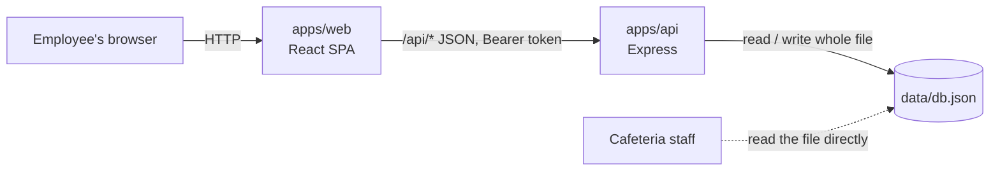

# Architecture — Cafetería

Derived from the code at `/tk-bootstrap` (2026-11-25), on an existing application. Every statement cites the evidence it was read from: `[OBSERVED: <file:line>]` for the code, `[GIVEN: <path>]` for what only an earlier document shows. What neither shows is **not decided**, and routed to `docs/project-context.md` §Open at handoff. There are no ADRs yet; the first story that changes an observed statement records one, and its citation replaces the `[OBSERVED]` one.

## 1. Purpose and audience

The system lets the company's employees order lunch from the internal cafeteria: see the day's menu, place an order, and see their own order history `[OBSERVED: README.md]` `[OBSERVED: apps/api/src/app.ts:34-70]`. Its users are employees who sign in with a work email and a PIN `[OBSERVED: apps/api/src/auth/session.ts:14-20]`; PINs are issued by Human Resources `[GIVEN: docs/notas.md]`. Cafeteria staff have no screen of their own today and read orders from the data file `[GIVEN: docs/notas.md]`.

This document is read by anyone planning or reviewing a change to the system. It does not cover the engagement — scope, change types, owners — which is `docs/project-context.md`.

## 2. Context

The application is an internal tool for one company's cafeteria, written in Peruvian Spanish and priced in soles `[OBSERVED: apps/web/index.html:2]` `[OBSERVED: apps/web/src/format.ts:1-4]`. The code describes itself as an internal demo, not a production system `[OBSERVED: apps/api/src/db/schema.ts:18]`.

The business situation — who sponsors it, whether it is meant to run in production, and what happens if it does not — is **not decided**.

## 3. Constraints

- **Runtime: Node.js 22 or later** `[OBSERVED: package.json]` `[OBSERVED: .nvmrc]`.
- **Interface language: Spanish (Peru).** Every user-facing string is Spanish, and dates are formatted in the `es-PE` locale `[OBSERVED: apps/web/src/components/MyOrders.tsx:22]` `[GIVEN: docs/pre-harness/AGENTS.md.txt]`.
- **Currency: soles, held as integer céntimos** `[OBSERVED: apps/api/src/db/schema.ts:1]` `[OBSERVED: apps/web/src/format.ts:1-4]`.

No hosting, region, compliance regime or platform mandate is shown anywhere in the repository — **not decided**. The reasons behind the constraints above are also **not decided**.

## 4. Overview

Two deployables in one npm-workspaces repository `[OBSERVED: package.json]`: a React single-page app and an Express JSON API. The web app calls the API through relative `/api/*` paths `[OBSERVED: apps/web/src/api.ts:36-48]`; in development Vite proxies them to the API on port 3001 `[OBSERVED: apps/web/vite.config.ts:6-9]`, and `npm run dev` at the root starts both `[OBSERVED: package.json]`. The API keeps all its data in one JSON file on local disk `[OBSERVED: apps/api/src/db/store.ts:12-21]`.

How the two are served outside development — what serves the web build, where the API runs, whether they share an origin — is **not decided**: the repository holds no Dockerfile, infrastructure code or CI workflow `[OBSERVED: git ls-files]`.

| App | Stack | Purpose |
|---|---|---|
| apps/web | React | Employee-facing single-page app: menu, cart, order history — React 18 on Vite 5 `[OBSERVED: apps/web/package.json]` |
| apps/api | Express | JSON API: sign-in, menu, orders, pricing — Express 4 on TypeScript, run with tsx `[OBSERVED: apps/api/package.json]` |

*Shows the runtime path of a request and where data lives. Omits the Vite dev proxy, the in-memory session table inside the API, and any production hosting, which is not decided.*

The root workspace holds no shared package: each app declares its own types, and the web app mirrors the API's types by hand `[OBSERVED: apps/web/src/api.ts:1-26]` `[OBSERVED: apps/api/src/db/schema.ts]`.

**Baseline coverage:** read every tracked file under `apps/api/` and `apps/web/` (all source, tests and config; `apps/web/src/styles.css` skimmed), the root manifests, `README.md`, `docs/notas.md` and `docs/pre-harness/AGENTS.md.txt`. Listed only: nothing — the application is 34 files.

## 5. Capability decomposition

| Capability | What it does | Realised by |
|---|---|---|
| Menu | Lists the day's items with price, category (main, drink, dessert, snack) and availability, plus the order limits; readable without signing in `[OBSERVED: apps/api/src/app.ts:34-36]` `[OBSERVED: apps/web/src/components/MenuList.tsx]` | apps/api, apps/web |
| Employee sign-in | Signs an employee in with email (case-insensitive) and PIN, issues a session token that lasts 8 hours, and signs out `[OBSERVED: apps/api/src/auth/session.ts:14-35]` `[OBSERVED: apps/web/src/components/LoginForm.tsx]` | apps/api, apps/web |
| Ordering | Builds a cart and places an order, refused when it is past the cutoff hour, empty, has an invalid quantity, names an unknown or unavailable item, or holds more than the item limit `[OBSERVED: apps/api/src/orders/validate.ts:18-32]` `[OBSERVED: apps/web/src/components/Cart.tsx]` | apps/api, apps/web |
| Pricing | Computes an order's subtotal, combo discount and total on the server `[OBSERVED: apps/api/src/pricing/total.ts:17-35]` | apps/api |
| Order history | Lists the signed-in employee's own orders, newest first, with status and total `[OBSERVED: apps/api/src/app.ts:64-70]` `[OBSERVED: apps/web/src/components/MyOrders.tsx]` | apps/api, apps/web |

No capability is governed by an ADR yet.

## 6. Cross-cutting concerns

**Identity.** An employee signs in with email and a four-digit PIN, matched against the employee records in the data file `[OBSERVED: apps/api/src/auth/session.ts:14-16]`. A successful sign-in returns a random token kept in an in-process `Map` with an expiry of `sessionHours` (8) `[OBSERVED: apps/api/src/auth/session.ts:11]` `[OBSERVED: apps/api/src/config.ts:16]`. The web app keeps the token in `sessionStorage` and sends it as `Authorization: Bearer` `[OBSERVED: apps/web/src/api.ts:34-43]`.

**Authorisation.** There is one role: a signed-in employee. **Critical control — authentication:** every route that reads or writes an employee's data goes through `requireAuth`, which rejects a missing, unknown or expired token with 401 `[OBSERVED: apps/api/src/auth/session.ts:41-52]` — today `POST /api/orders`, `GET /api/orders/mine` and `POST /api/auth/sign-out` `[OBSERVED: apps/api/src/app.ts:29,38,64]`. `GET /api/menu` and `GET /api/health` are public `[OBSERVED: apps/api/src/app.ts:14,34]`.

**Critical control — per-employee data isolation.** An order's owner is taken from the session, never from the request body `[OBSERVED: apps/api/src/app.ts:53]`, and an employee's order list is filtered by the session's employee `[OBSERVED: apps/api/src/app.ts:67]`.

**Critical control — what an employee pays.** Unit prices are read from the menu on the server, never from the client `[OBSERVED: apps/api/src/app.ts:46-50]`, and totals are computed on the server `[OBSERVED: apps/api/src/app.ts:55]`. The combo rule: each main paired with a drink is a combo, pairing the most expensive mains with the cheapest drinks, and 10% of the paired items' value is taken off, rounded to the nearest céntimo `[OBSERVED: apps/api/src/pricing/total.ts:3-35]`. Each order line stores the unit price at the time of ordering `[OBSERVED: apps/api/src/app.ts:46-50]`.

**Critical control — order acceptance rules.** Validated on the server before anything is stored `[OBSERVED: apps/api/src/app.ts:41-45]`: the cutoff hour (15:00, the server's local time), at most `maxItemsPerOrder` (10) items counting quantities, positive integer quantities, known and available items `[OBSERVED: apps/api/src/orders/validate.ts:18-32]` `[OBSERVED: apps/api/src/config.ts:10,13]`. A refusal is a 422 with a machine-readable `error` code `[OBSERVED: apps/api/src/orders/validate.ts:9-15]`, which the web app turns into a Spanish message `[OBSERVED: apps/web/src/format.ts:17-33]`.

**Error handling.** API errors are JSON `{ error: <code> }` with 401 or 422 `[OBSERVED: apps/api/src/app.ts:22,43]`; there is no error-handling middleware, so anything else falls to Express's default `[OBSERVED: apps/api/src/app.ts]`. In the web app, `call` throws an `ApiError` carrying the code `[OBSERVED: apps/web/src/api.ts:44-47]`; the cart shows it `[OBSERVED: apps/web/src/components/Cart.tsx:29-31]`, sign-out swallows a failed call `[OBSERVED: apps/web/src/api.ts:61]`, and the menu and order-history fetches have no failure handling `[OBSERVED: apps/web/src/App.tsx:18]` `[OBSERVED: apps/web/src/components/MyOrders.tsx:9]`.

**Observability.** One log line when the API starts `[OBSERVED: apps/api/src/index.ts:7-9]`; no request logging, metrics or tracing.

**Configuration and secrets.** Two environment variables, `PORT` and `DATA_FILE`, both with defaults `[OBSERVED: apps/api/src/config.ts:4,7]`. The business settings — item limit, cutoff hour, session length — are constants in `config.ts` `[OBSERVED: apps/api/src/config.ts:9-16]`; the combo percentage is a constant in `pricing/` `[OBSERVED: apps/api/src/pricing/total.ts:4]`. No secret is read from anywhere; `.env` is git-ignored but nothing loads one `[OBSERVED: .gitignore]`.

## 7. Data

Everything is stored in one JSON file holding `menu`, `employees` and `orders` `[OBSERVED: apps/api/src/db/schema.ts:41-45]`, at `DATA_FILE` or `apps/api/data/db.json` by default `[OBSERVED: apps/api/src/config.ts:7]`, which is git-ignored `[OBSERVED: .gitignore]`. On first start the API creates it from a seed — ten menu items and two test employees `[OBSERVED: apps/api/src/db/store.ts:13-16]` `[OBSERVED: apps/api/src/db/seed.ts]`. Every read parses the whole file and every write rewrites it; there are no transactions or locking `[OBSERVED: apps/api/src/db/store.ts:17-20]`. Tests use an in-memory store behind the same interface `[OBSERVED: apps/api/src/db/store.ts:23-32]`.

| Record | Holds |
|---|---|
| Menu item | id, name, description, category, price in céntimos, available `[OBSERVED: apps/api/src/db/schema.ts:5-12]` |
| Employee | id, email, name, PIN in plain text `[OBSERVED: apps/api/src/db/schema.ts:14-20]` |
| Order | id, employee, lines (item, quantity, unit price), subtotal, discount and total in céntimos, status, created-at `[OBSERVED: apps/api/src/db/schema.ts:22-39]` |

Order status can be `received`, `ready`, `delivered` or `cancelled` `[OBSERVED: apps/api/src/db/schema.ts:28]`; the code only ever writes `received` `[OBSERVED: apps/api/src/app.ts:56]`.

There is no migration mechanism: the file's shape is whatever `schema.ts` declares, and an existing file is not upgraded `[OBSERVED: apps/api/src/db/store.ts:12-21]`. Sessions are not stored; they live in the API's memory `[OBSERVED: apps/api/src/auth/session.ts:11]`.

The data includes personal data — employee names, work emails and PINs, and what each employee ordered. Its classification, residency, retention and backup are **not decided**.

## 8. Non-functional design

What the code sets: a session lasts 8 hours `[OBSERVED: apps/api/src/config.ts:16]`; orders close at 15:00 server time `[OBSERVED: apps/api/src/config.ts:13]`. There are no timeouts, caching, rate limits or scaling configuration `[OBSERVED: apps/api/src/app.ts]`. The design is single-process by construction: sessions live in one process's memory and the data file is rewritten whole with no locking `[OBSERVED: apps/api/src/auth/session.ts:11]` `[OBSERVED: apps/api/src/db/store.ts:17-20]`.

No availability, latency, capacity or recovery target exists — **not decided**.

## 9. Risks and accepted trade-offs

What the code visibly trades away. **Who accepted each is not decided** — none was recorded.

- **PINs are stored and compared in plain text** `[OBSERVED: apps/api/src/db/schema.ts:18-19]` `[OBSERVED: apps/api/src/auth/session.ts:16]`, justified in the code as a demo `[OBSERVED: apps/api/src/db/schema.ts:18]`.
- **Sign-in is not throttled.** A four-digit PIN has 10,000 values and nothing limits attempts `[OBSERVED: apps/api/src/app.ts:18-27]`.
- **Sessions are lost on every restart** and cannot be shared across processes `[OBSERVED: apps/api/src/auth/session.ts:11]`.
- **The JSON-file store** has no transactions, locking, backup or migration; it is safe only with one API process, and a corrupt file fails every request `[OBSERVED: apps/api/src/db/store.ts:12-21]`.
- **The seed runs in any environment.** A fresh data file always gets the two test employees `[OBSERVED: apps/api/src/db/store.ts:13-16]`.
- **The cutoff follows the server's clock and time zone** `[OBSERVED: apps/api/src/orders/validate.ts:19]`.
- **The web app's types are a hand-kept copy of the API's**, with nothing checking that they match `[OBSERVED: apps/web/src/api.ts:1-26]` `[GIVEN: docs/pre-harness/AGENTS.md.txt]`.
- **Web failures are partly silent.** A failed menu or order-history fetch leaves the screen empty or loading, and an expired session is only explained in the cart `[OBSERVED: apps/web/src/App.tsx:18]` `[OBSERVED: apps/web/src/components/MyOrders.tsx:9]` `[OBSERVED: apps/web/src/format.ts:28-29]`.
- **Test coverage is uneven.** The API has tests for sign-in, ordering and pricing; the web app tests only its formatting helpers, and no component or end-to-end test exists `[OBSERVED: apps/api/test/]` `[OBSERVED: apps/web/test/format.test.ts]`.
- **Nothing checks a change mechanically.** No git hooks, no CI, no lint `[OBSERVED: git ls-files]`.
- **There is no deployment path** in the repository `[OBSERVED: git ls-files]`.
